You're right, and I over-expanded. The report needs **one research question and one main experiment**. Most of what I listed doesn't need to be a separate experiment: it's either a description of your setup, or an extra row in the same experiment.

## One question

> *Does the quality of the evaluation signal determine how well an agent can improve its own skills?*

## One experiment: planted-defect repair

1. Take a few good skills (say 3) and plant known defects in each (say 3: missing clarification, missing step, wrong parameter guidance). That gives 9 broken skills.
2. Run one improvement method (SkillRevise) on each broken skill, changing **only** the signal it optimizes against.
3. Measure the results with the independent referee: was the planted defect actually fixed?

## One table

Every "experiment" from before becomes a row in it:

| Signal (rows) | Ranks variants correctly? | Defects fixed | Iterations to fix |
|---|---|---|---|
| Generic LLM judge | | | |
| Method's native signal | | | |
| Outcome-only (your head without process checks) | | | |
| Your head, restricted coverage | | | |
| Your head + 20% label noise | | | |
| Your head (full) | | | |

That one table covers everything:
- **"Mine beats baselines":** compare the first two rows with the last.
- **"Process checks matter":** the outcome-only row.
- **"Coverage matters":** the restricted-coverage row.
- **"Signal is the ceiling":** the noise row, plus the overall trend.

The first metric column costs almost nothing: you just score the broken and fixed variants, with no optimization loop. The scatter plot of the first column against the second is your one key figure.

## Where everything else goes

- **BEAM / memory work:** Chapter 2, as the original goal and why you changed direction. One table, no new experiments.
- **The framework (heads, generator, coverage):** Chapter 3, as the method. Report suite size, coverage and validity as a few numbers describing the test suite, the way the example report describes its dataset. They're not separate experiments.
- **Extensibility and domain-user authoring:** one paragraph in Chapter 3 and Future Work.
- **Trace2Skill and skill creation:** Future Work.

## If time runs out

Report only the first metric column: whether each signal ranks the planted variants correctly. That's pure evaluation, takes a couple of days, and still answers a narrower version of the question. The full repair loop then becomes your "next step."

Here's what that key figure would look like. The numbers are made up, just to show the shape of the result you'd hope for; the chart follows.

Each dot is one row of the table: one signal you plugged into the improvement loop. Both axes come from the same planted-defect setup:

- **X axis (cheap, no optimization):** For each planted-defect skill, ask the signal to score the original skill and the broken version. The x value is the percentage of pairs where the original scores higher. It measures whether the signal can even tell good from bad.
- **Y axis (the expensive part):** Run SkillRevise on each broken skill using that signal. The y value is the percentage of planted defects that are actually gone afterwards. You check that directly, not with any of the signals, so the comparison is fair.

**How to read it:** If the dots climb from bottom left to top right, signal quality predicts how well improvement works. That's your thesis in one picture.
- Where your full head lands (top right) is your "mine is best" result.
- The purple dots below it show what each component contributes: the process checks (outcome-only) and coverage (restricted coverage).
- The noise dot shows that degrading your own signal drags the result down too. That's the "signal is the ceiling" claim.

Your real data won't fall on such a clean line, and that's fine. If one baseline breaks the trend, for example a signal with good alignment that still doesn't help repair, that's an interesting finding to discuss in Chapter 4, not a failure.