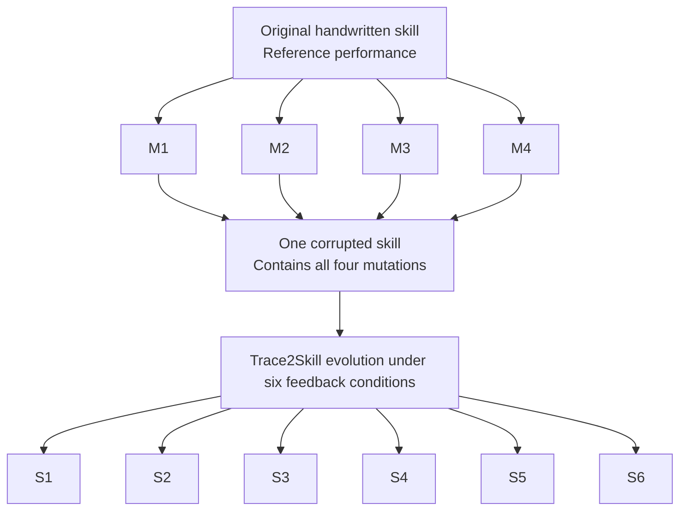
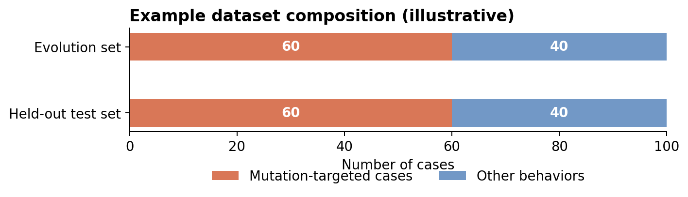
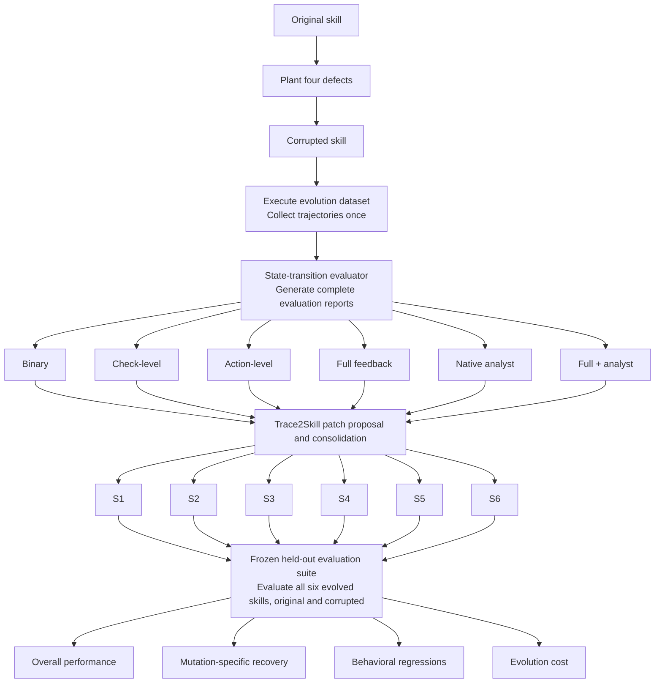
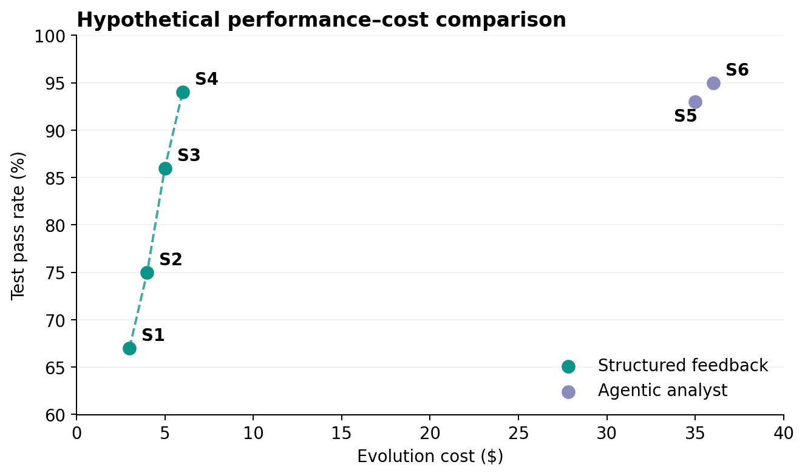
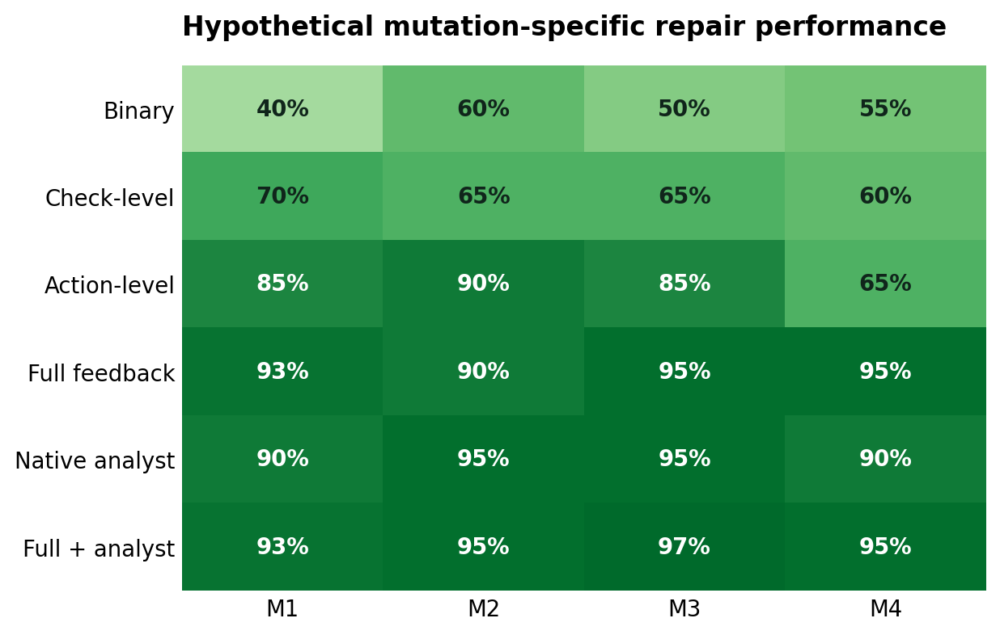

# Trace2Skill research discussion

*Conversation excerpt beginning with “is this in align with what i have in mind”. The text and tables are preserved; interactive visuals have been converted to static figures or Mermaid diagrams. All illustrative results are hypothetical.*

## User

is this in align with what i have in mind:

I built an evaluation framework for our risk analysis agent using three handwritten skills, one each for the FXO, GSP Muni and GSP Investment Grade desks. The framework represents a single agent turn as a state diagram. The states are scope (is the request within scope), skill selection (did the agent invoke a skill), flow selection and execute. The edges are actions that take a parameter, such as Invoke(x), where x is a skill or None, or Run(funcs), where funcs is a list of functions and parameters ran. Each test case is one expected path through the diagram. At each state or edge we check things like whether the agent picked the right skill, called the right functions with the right parameters, or asked for clarification when it should have. That lets us generate test cases at scale from all possible paths, weighted to match what we expect in production. The same framework covers agent evaluation and skill evaluation just by changing which combinations of checks are applied.

The idea is whether this framework can be substituted improve memory/skill improvement mechanisms, as published skill-improvement methods such as Trace2Skill relies on an evaluator signal that tht eimprovementment agent iterates on. But I see two limitations:

1. It assumes a golden dataset with simple right/wrong answers, which agents in production don't have. (our approach also does not solve this cost-free but it seems more feasible as the same generation pipeline we use can help us genertate expected paths for real traces)
2. It uses a separate failure-analysis agent. If we already have expected paths, structured feedback could replace that agent and cut cost significantly.

The idea is to mutate a working skill say in four different areas. each area will have test cases generated and we split this into train vs test. we then run this broken skill (al four mutations) via T2S for the training test cases (do we only use these or the whole suite for the skill including parts we didnt edit) but mutliple variants where aeach one provies T2S with a sdifferen tgranularity of feedback.

So now we have 4 (say we have 4 granularity variants) + original T2S WITH analyst agent + original T2S without analyst agent = 6 new skills. each of them will be used to evaluate on test data set (again just mutated test cases or evertyhing + mutated test case). we compare overall improvements and costs needed in t2s to get there for each we can also compare scores iwthin each mutation category.

---

## ChatGPT

Yes. **This is aligned with what I have in mind, and I think we are now converging on a concrete research plan.** You have the motivation, technical contribution, research question and experimental design.

There are just a few decisions I would refine, particularly around which test cases to use, how to introduce mutations, and how to define the six experimental conditions.

### 1. Your research motivation

Your two criticisms of Trace2Skill are valid starting points, but I would phrase them slightly differently for academic accuracy.

| Limitation | Your proposed contribution |
|---|---|
| Reliance on ground-truth supervision, which is expensive to construct for complex enterprise agents. | A parameterized state-transition framework that enables systematic generation of test cases with expected behaviors. |
| Computationally expensive agentic failure analysis. | Structured evaluation feedback that potentially provides sufficient diagnostic information without requiring a separate analyst. |

Two important qualifications:

- Trace2Skill is not restricted to simple right/wrong answers. Rather, its approach requires a way to determine correctness, which becomes considerably harder for complex, multi-step enterprise workflows.
- Your framework does not automatically solve ground-truth generation for arbitrary production traces. It makes **generating labeled evaluation scenarios** more systematic. Extending it to label existing production traces is a potential future direction, not something you have demonstrated yet.

I would make the second limitation your primary experimental motivation and the first limitation your motivation for developing the evaluation framework.

### 2. Should you mutate all four areas in one skill?

Yes, given your budget constraints, I would start with that approach.

Suppose your original GSP Investment Grade skill performs well. You intentionally introduce four defects:

| Mutation | Type | Example |
|---|---|---|
| M1 | Decision | Remove clarification guidance |
| M2 | Flow selection | Introduce incorrect subflow selection criteria |
| M3 | Procedure | Remove a mandatory function call |
| M4 | Parameter | Introduce incorrect date parameter guidance |



*Six independently evolved skills, all starting from the same corrupted skill.*

This gives you six evolved skills instead of the 24 you would have if you mutated each area independently.

There is one trade-off: mutations can interact. For example, incorrect flow selection may prevent the agent from ever reaching the execution step where another mutation would manifest.

I would therefore select mutations that affect reasonably independent behaviors, and verify that each mutation actually causes observable failures before proceeding.

If you had unlimited resources, independent mutations would be scientifically cleaner. But the combined approach is reasonable for your report, provided you acknowledge this limitation.

### 3. Should you train and test on mutated cases only or the entire suite?

**Train on a mixture. Test on the entire held-out suite.**

This is important because you want to investigate two things:

- Can Trace2Skill repair broken behavior?
- Can it do so without damaging existing correct behavior?

Imagine you have a dataset of 200 cases.



*Illustrative allocation, not a prescribed sample size.*

| Category | Train | Test |
|---|---:|---:|
| M1 — Clarification | 15 | 15 |
| M2 — Flow selection | 15 | 15 |
| M3 — Procedure | 15 | 15 |
| M4 — Parameter | 15 | 15 |
| Other behaviors | 40 | 40 |

#### Why include unaffected behaviors in training?

Because otherwise you're creating an artificially favorable situation where every piece of experience supplied to the optimizer concerns a defect that you deliberately introduced.

In reality, the optimizer needs to learn from a mixture of successful and unsuccessful experiences without being told which parts of the skill were intentionally corrupted.

Trace2Skill supports learning from both successful and failed trajectories, as well as an error-only configuration. ([Trace2Skill repository](https://github.com/Qwen-Applications/Trace2Skill))

I would use its combined success/error configuration, keeping the success-analysis pipeline identical across all conditions.

If budget is tight, you could instead use error-only evolution consistently across all conditions. You would still evaluate unaffected behaviors in testing.

#### Why include unaffected behaviors in testing?

Consider these hypothetical results:

| | Broken skill | Evolved skill |
|---|---:|---:|
| Mutation-targeted cases | 40% | 90% |
| Unaffected cases | 95% | 65% |

If you only evaluated mutation-targeted cases, you would conclude that the improvement mechanism was extremely effective.

But it also introduced significant regressions.

Your framework is especially valuable because it can measure both.

### 4. What exactly are the six feedback variants?

I would define them as follows.

| ID | Feedback supplied | Agentic analyst |
|---|---|---|
| S1 | Raw trace + failure label | No |
| S2 | Raw trace + individual check results | No |
| S3 | S2 + expected and observed actions | No |
| S4 | S3 + expected and observed action parameters and paths | No |
| S5 | Native-style Trace2Skill diagnostic pipeline | Yes |
| S6 | S4 + agentic investigation | Yes |

There is a small change from your proposed six conditions.

Trace2Skill already has a single-call error analysis baseline in its paper, called `+Error LLM`, which analyzes execution logs without interactive investigation. Section 4.1 and Appendix C.1 compare this against its agentic analyst. ([Trace2Skill paper](https://arxiv.org/pdf/2603.25158))

Your S1 could therefore serve as an adaptation of that baseline. You don't necessarily need a separate, nearly identical condition for original Trace2Skill without its agentic analyst.

Instead, I would use that sixth condition to investigate whether the analyst provides additional value **even when given your most granular feedback**.

This allows for three particularly meaningful comparisons:

| Comparison | What it answers |
|---|---|
| S1 → S4 | Does increasing feedback granularity improve skill repair? |
| S4 vs. S5 | Can structured feedback compete with conventional agentic diagnosis at a lower cost? |
| S4 vs. S6 | What additional value does agentic investigation provide when detailed diagnostics are already available? |

That last comparison is especially useful for answering *to what extent* your framework can replace an analyst.

Note that removing the agentic analyst does not remove the need for LLM reasoning entirely. You still need an LLM to interpret the feedback, propose skill edits and consolidate patches. What you are removing is the expensive interactive investigation loop.

### 5. An example of the different granularities

Suppose the correct function call is:

```python
get_stress_pnl(
    desk="GSP_IG_CA",
    scenario="rates_up_100bp"
)
```

But the agent calls it with the wrong scenario.

**S1 — Binary**

```json
{"result": "FAIL"}
```

**S2 — Check-level**

```json
{
    "function_sequence": "PASS",
    "function_parameters": "FAIL"
}
```

**S3 — Action-level**

```json
{
    "state": "execute",
    "failed_action": "get_stress_pnl",
    "failure": "incorrect_parameters"
}
```

**S4 — Full parameterized state-transition feedback**

```json
{
    "state": "execute",
    "action": "get_stress_pnl",
    "parameter": "scenario",
    "expected": "rates_up_100bp",
    "observed": "rates_up_50bp"
}
```

Every condition sees the same original corrupted skill and execution trace. Only the additional diagnostic information changes.

Keep the underlying pass/fail labels identical across S1–S6. Otherwise, you would be testing both failure detection and feedback granularity simultaneously.

### 6. Your entire experiment



You end up with eight skills to evaluate, but only six need to undergo evolution.

### 7. What your final results could look like

I would make this your main results table.

*Hypothetical results, not experimental findings.*

| Skill | M1 | M2 | M3 | M4 | Other | Overall | Cost |
|---|---:|---:|---:|---:|---:|---:|---:|
| Original | 93% | 95% | 97% | 95% | 95% | 95% | — |
| Corrupted | 20% | 40% | 30% | 50% | 95% | 59% | — |
| S1 | 40% | 60% | 50% | 55% | 90% | 67% | $3 |
| S2 | 70% | 65% | 65% | 60% | 90% | 75% | $4 |
| S3 | 85% | 90% | 85% | 65% | 93% | 86% | $5 |
| S4 | 93% | 90% | 95% | 95% | 95% | 94% | $6 |
| S5 | 90% | 95% | 95% | 90% | 93% | 93% | $35 |
| S6 | 93% | 95% | 97% | 95% | 95% | 95% | $36 |

These results would allow you to investigate both of your research questions.

**A. Can structured feedback replace the analyst?**



*The desirable region is the top left: high performance at low computational cost.*

**B. Which feedback is most useful for which types of mutations?**



| Signal | M1 | M2 | M3 | M4 |
|---|---:|---:|---:|---:|
| Binary | 40% | 60% | 50% | 55% |
| Check-level | 70% | 65% | 65% | 60% |
| Action-level | 85% | 90% | 85% | 65% |
| Full feedback | 93% | 90% | 95% | 95% |
| Native analyst | 90% | 95% | 95% | 90% |
| Full + analyst | 93% | 95% | 97% | 95% |

For example, you might discover that check-level feedback is sufficient for repairing clarification defects, but explicit parameter discrepancies are necessary for repairing parameter defects.

That could inform how future self-improving systems dynamically select the appropriate level of feedback rather than performing expensive analysis for every failure.

### 8. A few important experimental controls

Before implementing this, I would establish the following:

- **Mutation validity:** Verify that each planted defect actually lowers performance and is repairable through skill edits rather than system prompt or model changes.
- **Data separation:** Hold out distinct scenarios and parameter combinations, not merely different phrasings of the training queries.
- **Controlled evolution:** Keep the optimizer model, initial trajectories, patch consolidation, success-analysis strategy and evolution rounds consistent.
- **Reproducibility:** Ideally repeat each evolution condition three times to account for LLM randomness. If budget prevents this, acknowledge it.
- **Evaluation validity:** Allow multiple legitimate execution paths where appropriate. Otherwise, your optimizer might learn to satisfy an overly rigid specification rather than genuinely improve.
- **Cost accounting:** Include diagnostic calls, patch generation, verification, consolidation and any LLM calls required by your evaluator. Separately disclose the human cost of constructing the evaluation framework.

### 9. Your research project, in its simplest form

**Research question**

> To what extent can structured, state-transition-based evaluation feedback substitute for agentic failure analysis in automated skill evolution, and how does its effectiveness vary across different types of skill defects?

**Technical contribution**

A reusable state-transition evaluation framework that enables systematic test generation, behavioral verification and configurable diagnostic feedback.

**Experimental contribution**

A controlled, multi-defect skill-repair experiment using Trace2Skill to compare feedback granularity, repair effectiveness, behavioral preservation and computational cost.

**Future work**

Automatic labeling of production trajectories, adaptive feedback selection and generalization across additional skills and domains.

---

I think this is a coherent and sufficiently substantial MScAC research project. I would not add the coverage, label-noise or evaluator-ranking experiments at this stage.

You already have a clear research story: **instead of spending more computational resources investigating why agents fail, can we design evaluation frameworks that make their failures more informative in the first place?**

---

## User

what is the research question

## ChatGPT

**Primary research question:**

> To what extent can structured, state-transition-based evaluation feedback replace agentic failure analysis in automated skill evolution while maintaining repair effectiveness and reducing computational cost?

**Two subquestions:**

1. **Feedback granularity:** How does the granularity of evaluation feedback affect skill repair effectiveness across different types of skill defects?
2. **Cost-effectiveness:** Can sufficiently granular evaluation feedback achieve comparable or better skill improvement than agentic failure analysis at a lower computational cost, without introducing behavioral regressions?

This gives you one overarching research question and two subquestions that can be answered through the same controlled mutation-repair experiment.

Your evaluation framework is the **proposed method**, Trace2Skill is the **experimental vehicle**, and feedback granularity is the **independent variable**.

The broader research motivation is understanding how evaluation design influences an agent's capacity for self-improvement.
